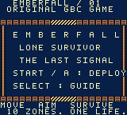
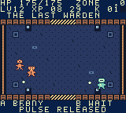
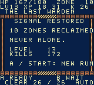

# 余烬独行 / Emberfall: Lone Survivor

**专为 ModRetro Chromatic 制作的原创像素风打怪闯关游戏，采用原生 Game Boy Color（GBC）ROM 格式。**

**An original pixel-art arena survival game built for ModRetro Chromatic, delivered as a native Game Boy Color ROM.**

[在线试玩 / Play now](https://svenkunkka.github.io/emberfall-chromatic/) · [中文](#中文说明) · [English](#english) · [下载 / Download](https://github.com/SvenKunkka/emberfall-chromatic/releases/latest)

| 开场 / Title | 战斗 / Combat | 通关 / Ending |
| --- | --- | --- |
|  |  |  |

## 中文说明

你是废土中的独行者。在十个战斗区域中躲避追击、自动射击、击杀升级，并击败守望者首领，恢复最后的信号。

### ModRetro Chromatic 适配

| 项目 | 说明 |
| --- | --- |
| 目标掌机 | **ModRetro Chromatic** |
| 游戏格式 | 原生 `.gbc`，GBC-only，128 KiB；不是网页游戏的掌机外壳 |
| 画面 | 原生 160×144 像素，8×8 场景图块与像素角色 |
| 操作 | 十字键移动，A 冲刺，B 脉冲，Start 开始／暂停，Select 查看指南 |
| 显示适配 | 按 Game Boy Color 精灵与调色板限制制作，运行时控制每条扫描线的对象数量 |
| 已验证 | 真实 ROM 编译、PyBoy 模拟器完整通关、官方 Binjgb 浏览器导出试玩 |
| 实机状态 | **尚未在物理 ModRetro Chromatic 上安装或验证**；模拟器测试不等于实机验收 |

本项目是面向 Chromatic 的独立游戏，不是 ModRetro 官方产品，也未获 ModRetro 背书。其他 Game Boy Color 兼容设备不在本次实机验证范围内。

### 下载与开始

**[直接打开在线试玩](https://svenkunkka.github.io/emberfall-chromatic/)**，无需安装。电脑按 Enter 开始，方向键移动，Z 冲刺，X 脉冲；手机使用屏幕上的十字键与 A / B / Start。

到 [Releases](https://github.com/SvenKunkka/emberfall-chromatic/releases/latest) 下载 `Emberfall.gbc`；同时提供源码与验收素材压缩包。它是可供 Chromatic 兼容卡带工作流或 GBC 模拟器使用的游戏 ROM；设备写入请按你的设备与官方工具说明操作。

下载源码后，用 **GB Studio 4.3.2** 打开 `project.gbsproj`。`plugins/emberfall/engine/` 中保留自定义战斗场景 C 源码，像素源图和资源元数据也可以继续编辑。

### 游戏内容

- 10 个连续战斗阶段、5 组区域配色，共 170 只普通怪物和 2 名首领。
- 自动选择最近目标并以八方向弹道射击，玩家负责移动、冲刺和范围脉冲。
- 爬行者、疾行者、重装怪、喷吐者，以及第 5、10 关的守望者首领。
- 击杀获取经验，升级增加攻击和生命；关间从攻击、射速或生命强化中三选一。
- 暂停、失败重开、通关结算和芯片音效。

各阶段共用开放竞技场，改变怪物组合、强度、刷新速度和配色；不是十张不同迷宫地图。首版游戏界面为英文，**没有持久存档**，关闭后重新开始。

### 操作

| 动作 | Chromatic | 浏览器键盘 |
| --- | --- | --- |
| 移动 | 十字键 | 方向键 |
| 自动射击 | 自动 | 自动 |
| 冲刺闪避 | A | Z |
| 范围脉冲 | B | X |
| 开始／暂停／继续 | Start | Enter |
| 标题页指南 | Select | P |
| 关间强化 | 上下选择，A 确认 | 上下选择，Z 确认 |

### 工程与验证

| 位置 | 内容 |
| --- | --- |
| `project.gbsproj` / `project/` | 原生可编辑项目、场景、演员、设置和调色板 |
| `assets/` | PNG 像素素材与原生资源元数据 |
| `art-source/` / `tools/author_art.py` | 可编辑像素格与素材重建脚本 |
| `plugins/emberfall/engine/` | 自定义战斗场景、技能、怪物、成长和关卡数值 |
| `tools/playtest.py` | 只发送普通按键的 ROM 回归测试 |
| [设计与数值](docs/设计与数值.md) | 完整玩法、成长公式与怪物属性 |
| [关卡数值 CSV](docs/关卡数值.csv) | 可编辑的十关数值表 |
| [验收记录](docs/验收记录.md) / `release-manifest.json` | 验证范围与已验收 ROM 摘要 |

已通过完整十关、两名首领、三种强化、暂停和失败重开测试。测试只读取编译符号对应的状态，**没有写内存、修改生命或跳关**。最终两条测试路线的扫描线抽样峰值均为 10，超限抽样数为 0。

构建使用官方 GB Studio CLI 的 `make:rom` / `make:web`。本仓库不包含编译器；回归测试需要 PyBoy 2.7.0，以及同一次 ROM 编译导出的 `build/Emberfall.gbc.debug/symbols.noi`。官方浏览器导出只是另一种试玩入口，原生 `.gbc` 是掌机交付文件。

### 参考与素材来源

最初制作要求将《我在废土独自升级》作为参考。2026-11-11 的公开检索未取得可核验的官方逐关数值或完整战斗公式，因此本作数值与新增美术自行设计，不宣称复刻原作。

保留上游 [MIT License](LICENSE)。字体、原始 UI 和保留的工作坊模板来自 ModRetro Chromatic 插件的 Original starter；新增战斗像素图、竞技场和玩法代码为本项目原创。

---

## English

**Emberfall: Lone Survivor is built for ModRetro Chromatic as a native Game Boy Color game.** Survive ten wasteland combat zones, grow stronger through kills and salvage, defeat two Wardens, and restore the last signal.

### ModRetro Chromatic compatibility

- **Target handheld:** ModRetro Chromatic.
- **Cartridge format:** native `.gbc`, Game Boy Color only, 128 KiB.
- **Display:** native 160×144 pixels, tile-based scenery and pixel-art characters.
- **Controls:** D-pad movement, A dodge dash, B area pulse, Start start/pause, Select field guide.
- **Hardware-aware graphics:** Game Boy Color palettes and sprite budgets, including runtime per-scanline allocation.
- **Verified:** official ROM compilation, full input-only PyBoy playthroughs, and the official Binjgb browser export.
- **Physical hardware:** installation and play on a physical Chromatic **have not been tested**. Emulator success is not physical-device certification.

This is an independent game for Chromatic, not an official ModRetro product or an endorsement by ModRetro. Other GBC-compatible devices have not received physical-device testing.

### Download and play

**[Play instantly in your browser](https://svenkunkka.github.io/emberfall-chromatic/)** — no installation needed. Press Enter to start, use arrow keys to move, Z to dash and X for pulse. On phones, use the on-screen D-pad and A / B / Start controls.

Download `Emberfall.gbc` from [Releases](https://github.com/SvenKunkka/emberfall-chromatic/releases/latest) for your Chromatic-compatible cartridge workflow or a GBC emulator. Follow the instructions for your own device and official installation tools.

Open `project.gbsproj` in **GB Studio 4.3.2** to edit the game. The native resources, pixel grids, PNGs and project-local custom scene C source are included. The compiler is not bundled.

### Features

- Ten combat stages sharing one open arena, five regional color themes, 170 regular foes and two bosses.
- Automatic nearest-target selection with eight-direction shots, manual movement, invulnerable dash and area pulse.
- Crawlers, runners, brutes and acid spitters; Warden encounters in zones five and ten.
- XP levels and three salvage choices between zones: power, fire rate or vitality.
- Pause, retry, ending and chip sound effects. English in-game UI; no persistent save.

### Keyboard controls

Arrow keys move, **Z** is A/dash, **X** is B/pulse, **Enter** is Start, and **P** is Select. Use up/down and Z to confirm salvage upgrades.

### Editable source and validation

`project/` and `assets/` contain native GB Studio resources. `plugins/emberfall/engine/` implements the combat scene and balance. `art-source/` and `tools/author_art.py` preserve editable artwork. The Chinese design document and CSV contain the exact stage and progression values.

Both the standalone cartridge and browser-exported cartridge passed ten-zone playthroughs with normal button inputs. Tests cover both bosses, all upgrade choices, pause and retry, without memory writes or skip-level cheats. PyBoy 2.7.0 and matching compiler symbol artifacts are required for `tools/playtest.py`.

The requested reference game did not yield a verifiable official stage table or combat formula during public research on 2026-11-11. Balance and new artwork are original, not an asserted reproduction of that game.

The upstream [MIT notice](LICENSE) is retained. The font, original UI and retained workshop template come from the ModRetro Chromatic plugin's Original starter; combat artwork, arena and game logic were authored for this project.
